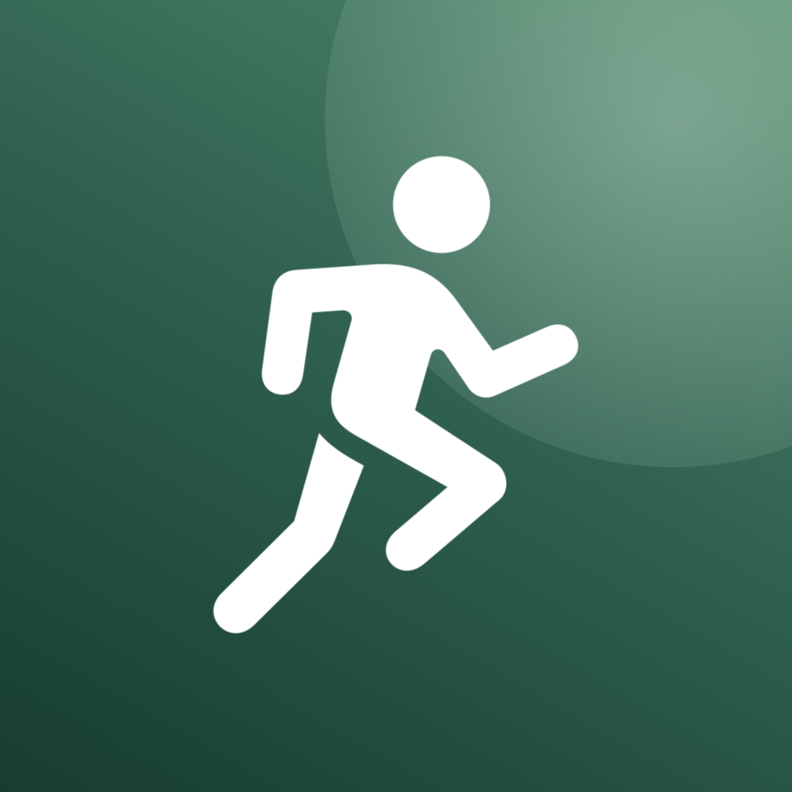
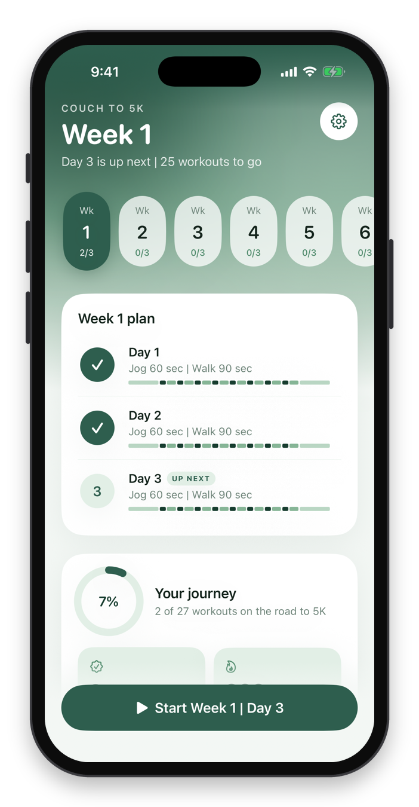
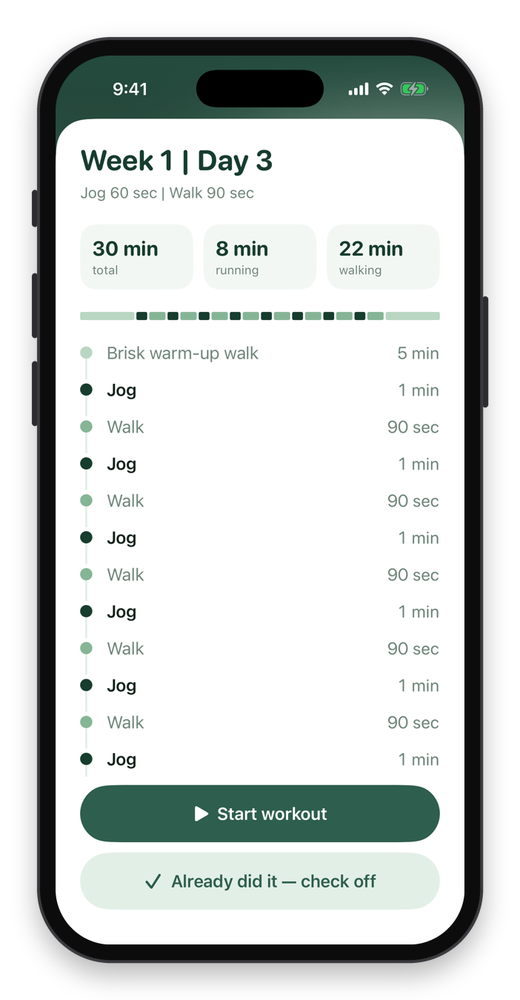
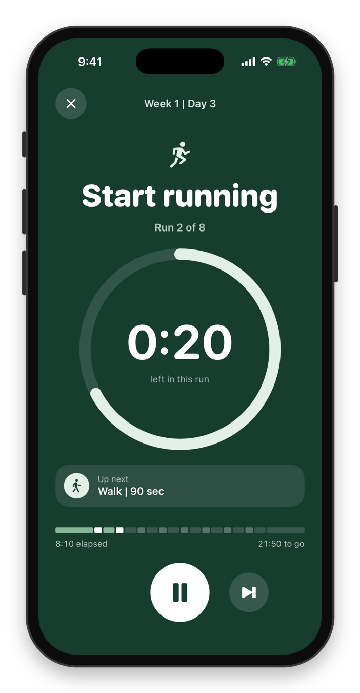
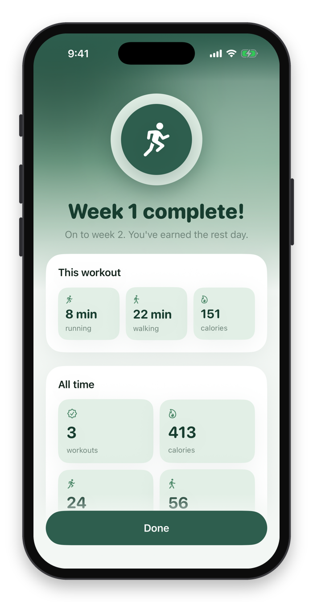

<p align="center">
  
</p>

<p align="center"><b>Couch to 5K</b><br>A simple, green iPhone app that gets you from the couch to running 5K in nine weeks.</p>

<p align="center">
  
  
  
  
</p>

## What it does

- **Follows the official plan.** Nine weeks, three workouts a week. Every workout starts with a 5-minute warm-up walk and ends with a 5-minute cool-down walk.
- **Tells you when to run and walk.** A big timer says "Start running" or "Start walking", counts down, and shows what's next.
- **Talks to you, even with the phone locked.** A friendly voice calls out each change, so your phone can stay in your pocket. Music keeps playing underneath.
- **Tracks your progress.** Workouts done, minutes running, minutes walking, and calories burned.
- **Celebrates.** Confetti and your stats at the end of every workout.
- **Lets you check off days.** Did a workout somewhere else? Tap the day's circle to mark it done.
- **Keeps your data on your phone.** No account, no server.

## Hear the voice

About 18 seconds of cues, with captions. Turn your sound on.

https://github.com/user-attachments/assets/59f6f74d-64c0-47e9-9588-3cf86610dfaf

The voice is "Gemma" from [Cartesia](https://cartesia.ai). Every cue is in [`C25K/Voice`](C25K/Voice).

## Put it on your iPhone

You need a Mac with Xcode and [XcodeGen](https://github.com/yonaskolb/XcodeGen) (`brew install xcodegen`).

1. Copy the signing settings file:
   ```bash
   cp Config/Secrets.example.xcconfig Config/Secrets.xcconfig
   ```
   Open it and add your Apple Developer Team ID, or leave it blank and pick a team in Xcode.
2. Make the Xcode project:
   ```bash
   xcodegen generate
   ```
3. Open `C25K.xcodeproj`, plug in your iPhone, pick it at the top, and press Run.

## Changing the voice

The voice clips are already in the repo, so you only need this if you want to change what it says or who says it.

1. Put your Cartesia API key in a `.env` file as `CARTESIA_API_KEY=...`.
2. Edit the lines in `Tools/make_voice.py` if you like, then run:
   ```bash
   uv run --no-project Tools/make_voice.py
   xcodegen generate
   ```

Your key is only used on your computer to make the clips. It never goes into the app.

## How it's built

SwiftUI and SwiftData, iOS 17 and up. The workout plan lives in `C25K/Model/Program.swift`, the timer in `C25K/Workout`, and the screens in `C25K/Views`.

The phone frames on the screenshots are drawn by `Tools/frame_screenshots.py`.
